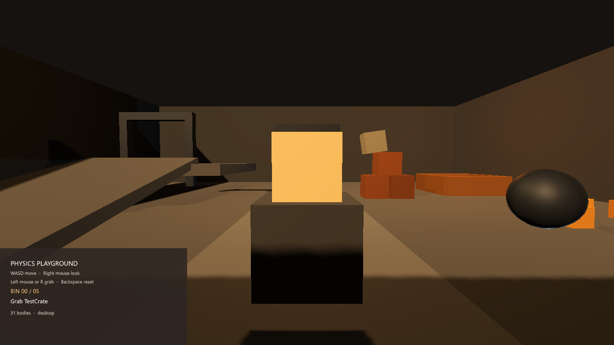

# Physics Playground



A compact training yard for the ground-level side of `V12.Physics`: a dynamic
player capsule, stacked crates, a heavy iron ball, a light drum, a moving
kinematic platform, static level geometry, trigger volumes and a bin you score
by throwing props into it.

Everything is primitives, so every collider is visible. The same world runs flat
and in VR.

## What it exercises

- Shared desktop/XR movement through `V12.Basic.Player.PlayerMotorComponent`,
  driving a dynamic capsule with `LocomotionComponent` plus
  `PhysicsBodyComponent`.
- An ADSR movement envelope (`Attack`, `Decay`, `Sustain`, `Release`) that gives
  the player weight on start, settle and stop.
- Static collidables, a continuous kinematic platform and a rotated ramp.
- `IPhysicsTriggerEvents` for the gate and the bin score.
- Per-body mass, damping and sleep settings.
- The reusable `GrabberComponent` / `GrabbableComponent` pair from
  `V12.Basic/Grabbing`, with desktop ray grab and two-hand XR grab.
- A screen-space Paper HUD for desktop and a world-space wrist canvas in XR,
  both retinted to the yard palette.

## Controls

**Desktop**

| Input | Action |
|---|---|
| `W A S D` | Move |
| Right mouse | Capture / release the pointer |
| Mouse | Look while captured |
| Left mouse or `R` | Grab / release the prop under the crosshair |
| `Space` | Jump |
| `Shift` | Sprint |
| `Backspace` | Reset the yard and the player |

**XR**

| Input | Action |
|---|---|
| Headset | Look |
| Left stick | Move relative to where you are looking |
| Right stick | Turn the rig |
| Trigger or grip | Grab with that hand; release to throw |
| Right primary button | Jump |
| Back button | Reset the yard |

The left wrist carries the score, target prompt and event text in XR. Tilt your
left hand toward your face to read it. The desktop HUD is hidden while XR is
active.

The player starts facing the test crate on the plinth. The crate sits on the
desktop eye line so the HUD should read `Grab TestCrate` immediately.

## Run

Build the sample:

```powershell
dotnet build V12-Samples\PhysicsPlayground\PhysicsPlayground.csproj
```

Flat desktop:

```powershell
Godot_v4.8-beta3_mono_win64_console.exe `
  --path NovaV2\NovaV2.Host `
  --xr-mode off -- `
  --game V12-Samples\PhysicsPlayground --xr 0
```

Or with the helper:

```powershell
.\scripts\run-host.ps1 -Demo PhysicsPlayground -UseGame -Xr off
```

With a headset, omit `--xr-mode off` and `--xr 0`. `manifest.json` sets
`"Xr": true`; if OpenXR fails to start the scene continues on the desktop
camera.

## Use the grabber in another game

The grabber is not sample code. It lives in `V12.Basic`:

- `V12.Basic/Grabbing/GrabberComponent.cs`
- `V12.Basic/Grabbing/GrabbableComponent.cs`

To reuse it:

1. Put `GrabberComponent` on the player element. It finds the current
   `CameraComponent` for desktop aim and the `XRHandComponent` children for VR.
2. Give each prop a dynamic `PhysicsBodyComponent` and a
   `GrabbableComponent`. `ThrowMultiplier` and `LockRotation` are per object.
3. Keep using the normal `interact` action and the host's
   `xr_<side>_trigger` / `xr_<side>_grip` axes. No extra input setup is needed.

If the physics body lives on a separate element, call
`grabber.SetPlayerBody(bodyComponent)` once it resolves. This is what this
sample does with `PlayerBody`, and it makes the desktop ray ignore the player's
own capsule instead of stopping on the camera's own collider.

The held body stays dynamic. The grabber drives its velocity toward the hand or
aim point, so it still collides, pushes other bodies and can be blocked by a
wall; after `BreakDelay` beyond `BreakDistance` it lets go instead of dragging
through geometry. On release the target velocity becomes throw velocity.

The legacy `PickupSystem` detects a `GrabberComponent` in the scene and stops
competing for `interact`.

## Layout

| File | Contents |
|---|---|
| `Scenes/Main.worldml` | Lighting, player rig, XR rig and HUD |
| `Scripts/PhysicsPlaygroundLevel.cs` | Yard geometry, props, triggers and reset poses |
| `Scripts/PhysicsPlaygroundController.cs` | HUD, score, triggers, grabber and wrist panel |
| `V12.Basic/Player/PlayerMotorComponent.cs` | Shared desktop/XR movement and ADSR envelope |
| `Scripts/MovingPlatformComponent.cs` | Slow kinematic platform motor |
| `Scripts/PhysicsPlaygroundGamePack.cs` | Registers `V12.Basic` services |

## MCP

The host can expose the running yard to the V12 MCP server:

```powershell
Godot_v4.8-beta3_mono_win64_console.exe `
  --path NovaV2\NovaV2.Host `
  --xr-mode off -- `
  --game V12-Samples\PhysicsPlayground --xr 0 `
  --mcp --mcp-token dev --mcp-port 7420
```

Then use `get_tree`, `find_elements` and `get_element` to inspect the props, and
`send_input` to drive the same input path as a player. `get_element` on `Player`
shows the live `GrabberComponent` state.

## Notes

- `Player` is the floor rig (XR origin plus desktop camera); `PlayerBody` is the
  separate capsule body at its centre. `PlayerMotorComponent` drives the body
  and syncs the floor rig from it every tick. That keeps the tracked headset
  origin on the floor instead of lifting it by half a capsule.
- Movement weight lives in the motor's `Attack`, `Decay`, `Sustain` and
  `Release` values in `Scenes/Main.worldml`. Raise `Attack`/`Release` for a
  heavier feel; lower them for a snappier character. `Sustain` is the fraction
  of top speed held after the decay settles.
- In XR the capsule target is the tracked head's horizontal position, not the
  play-space centre. Room-scale walking moves the body by the tracked delta,
  rotated by the rig yaw, and the rig subtracts the new head offset. The capsule
  stays under the player and physical forward follows the rig after a turn.
- The wrist canvas opts into `CanvasComponent.WorldShader = "flat"`. That world
  shader keeps the Paper font SDF but skips the brush and scissor masks, so the
  panel stays a clean square at steep viewing angles instead of picking up the
  pixel-space mask warp.
- The ramp is a rotated static box. The player is a dynamic capsule, not a Bepu
  character controller, so steep geometry is intentionally avoided.
- Trigger overlap is tested against broadphase bounds. The gate and bin volumes
  are simple boxes for that reason.
