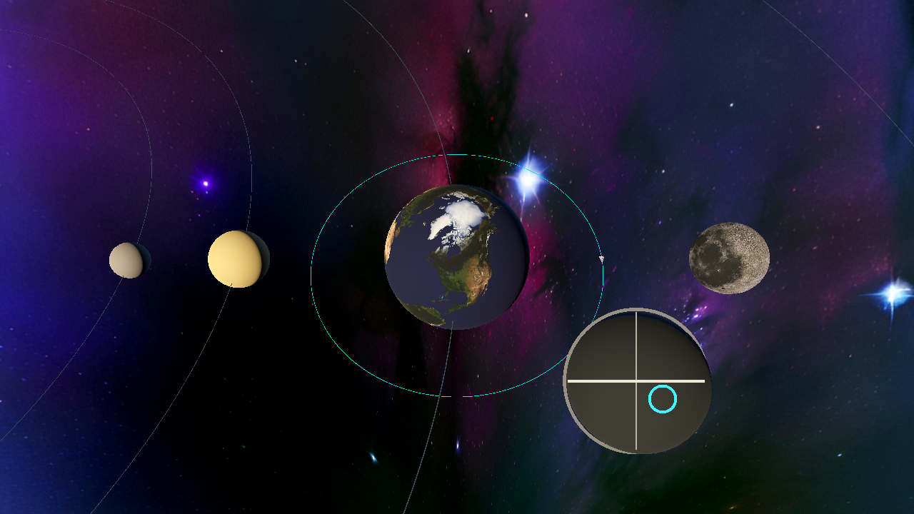

# Space Flight



A visual NovaV2 sample for the new `V12.Physics` and `V12.Gravity` packages.

The scene is a compact, scaled solar system. The ship is a normal Bepu body
falling around Earth while Earth orbits the Sun, all driven by point-mass
`GravitySourceComponent`s and the inverse-square field in `V12.Physics`.

## What you see

- A Sun at the origin with the `2k_sun.jpg` texture.
- Eight planets in solar order, all starting on the +X line and then orbiting
  at their own rates: Mercury, Venus, Earth, Mars, Jupiter, Saturn, Uranus and
  Neptune. Their orbit rings are drawn around the Sun.
- A 9,400-unit textured Earth at 270,000 units from the Sun, with a 10,900-unit
  circular ship orbit drawn as a live cyan tube.
- A textured 2,560-unit Moon orbiting Earth at 75,200 units. Its SOI is large
  enough to take over the local orbit frame before you reach it. Planets are
  solid sphere colliders and impacts are handled entirely by Bepu using the
  ship's contact proxy and the contact material.
- A 4096x2048 nebula panorama behind everything, rendered as the world sky.
- A dynamic rocket loaded from `Assets/rocket.glb`, with a held-space exhaust
  plume and the local circular velocity `sqrt(Mu / r)`, about 282 m/s. The
  visible hull is a 28 x 26 x 42 box but the contact proxy is a 28-unit sphere,
  so a landing slides instead of catching a corner and tumbling. Hull mass comes
  from the hull volume and a hull density; mass does not change a landing bounce
  against a kinematic planet, because the contact impulse scales with it.
- A cinematic camera that frames the planet the ship is currently orbiting
  (scaled for Mars/Luna), or chases the ship with a user-owned orbit angle.
  Arrow keys pan/tilt and `Q`/`E` zoom; the chase camera follows only the
  ship's position and does not rotate with the gravity field.
- A small navball fixed in the lower-right corner: a ship-relative horizon and
  meridian cross, with cyan prograde and red retrograde markers.
- Looped background music and a held-space thruster loop through the engine
  `AudioSystem` (see [Audio](#audio)).
- Console telemetry once per second: body name, altitude, speed, eccentricity,
  semi-major axis, apsides and period, computed by
  `V12.Gravity.OrbitalState`.

## Controls

| Key | Action |
|---|---|
| `[` | Slow the simulation down: 1x, 0.5x, 0.25x |
| `]` | Speed the simulation up: 2x, 4x, 8x |
| `B` | Prograde impulse burn, raises the orbit |
| `N` | Retrograde impulse burn, lowers the orbit |
| `W` / `S` | Pitch the ship up / down |
| `A` / `D` | Yaw the ship left / right |
| `Space` | Hold for continuous nose thrust |
| `C` | Toggle the planet orbit view and the ship chase camera |
| Arrow keys | Pan and tilt the chase camera around the ship |
| `Q` / `E` | Zoom the chase camera out / in |
| `T` | Cycle attitude: prograde, retrograde, tidal lock, free |
| `R` | Reset the ship to its starting circular orbit |

`WASD` drops the attitude hold into `Free` as soon as you touch it, so the
ship keeps the attitude you dial in. Press `T` to cycle back to prograde or
tidal lock. `Space` thrusts along the current nose direction, not along the
velocity vector, so it is also an attitude-control tool.

Time scale changes the engine fixed clock, so physics and planet motion speed
up. The fixed-step budget stays at 8 steps per rendered frame; raising it with
warp made high speeds run hundreds of physics steps per frame and collapse the
frame rate. Camera pan/tilt, zoom and manual `WASD` rotation use real frame time
instead of simulation time, so they stay responsive at any warp level.

`B` and `N` are real impulses on the ship body. The live orbit tube is computed
from `V12.Gravity.OrbitalState` around the body whose sphere of influence
currently contains the ship. Fly into the Moon's SOI and the tube recentres on
the Moon; the telemetry, navball horizon and cinematic camera follow the same
body. Its tube radius is constant, so a burn changes the ellipse without
visibly fattening the line. The full multi-body field perturbs the local conic,
so the real path and the two-body prediction slowly diverge.

Central gravity applies no torque, so a body with no control keeps its
orientation fixed in inertial space while the camera orbits the planet. The
sample runs a kinematic prograde attitude hold by default; `T` cycles
Prograde, Retrograde, TidalLock and Free. The rocket GLB gives the hull a real
nose and tail silhouette. This is a flight-assist visual, not a torque/RCS
simulation; `WASD` is a direct attitude command, not reaction-wheel physics.

The navball is ship-relative, not camera-relative: its centre is the nose, the
bone cross is the local planet's horizon and vertical, and the cyan/red rings
are the velocity and anti-velocity directions. Switch the attitude to `Free`
and the cross drifts as the hull holds its inertial attitude. These are
screen-space HUD curves and markers, not a physical globe, so the camera can
orbit without moving the instrument.

The chase camera captures its starting direction when you press `C`, then
freezes it in world space. The ship's changing velocity and the gravity field
no longer drag the camera around; only your arrow input changes the view angle.

`B` and `N` use small default impulses so a single tap does not throw the ship
out of the demo orbit. At the 10,900-unit reference orbit the circular speed is
281.9 m/s and escape speed is 398.8 m/s, so landing needs almost 282 taps of
`N` at 1 m/s each. Raise `BoostDeltaV` / `BrakeDeltaV` in
`SpaceFlightInputComponent` for larger changes.

The telemetry line reports velocity **relative to the planet**. The collider also
carries that planet's surface velocity now, so the speed in telemetry and the
speed the contact solves against agree; before that, Earth's 78 m/s orbital
motion was missing from the contact frame and a "10 m/s" landing was a 78 m/s
scrape.

The numbers are deliberately scaled for float32 comfort and a watchable
~243-second orbit. The same code path works at real scale; the constants live
at the top of `SpaceFlightScene.cs`.

`Docs/EcoVR-Planet-Design-Doc.docx` targets a 2,400 km, 1g working planet
(`PlanetProfile.EcoVRWorking`), which gives a low-orbit speed of about
4.85 km/s and a 52-minute period. The sample logs those doc numbers at startup
alongside its visual-scale numbers. A full-scale planet needs the
double-precision world / floating-origin layer described in the doc; the orbit
maths already run in double through `V12.Gravity`.

## Skybox

`Assets/skybox_space.jpg` is a 4096x2048 equirectangular nebula panorama
extracted from the original `skyboxspace.glb` (kept in `SourceAssets/`, outside
the pak). It is not a mesh: `SpaceFlightScene` sets the world's
`EnvironmentComponent` to `BackgroundMode.Skybox` with

```csharp
SkyboxPath = "v12://Assets/skybox_space.jpg",
```

which NovaV2 uploads once and draws through a `PanoramaSkyMaterial`. `SkyEnergy`
scales its brightness and `SkyboxRotation` yaws it in degrees if the interesting
part of the nebula is behind the camera. If the path or file is missing, the
host falls back to the dark solid sky colour and the scene still runs.

A mesh shell is the wrong tool here even though the source model is one: the GLB
bakes a 500-unit radius into its node transforms, so any element scale
multiplies that. A shell only works while it sits between the camera and the far
clip, and a single-sided one is culled once the camera is inside it.

## Audio

The scene uses the engine `AudioSystem` and `AudioSourceComponent`. NovaV2
registers `OwnAudioEngine` and runs Godot with the Dummy audio driver, so only
one side opens the output device.

- `Assets/spaceflight.mp3` autoplays on the `Music` bus at `Volume = 0.12` and
  loops.
- `Assets/benvibrant-thruster-loop-562715.mp3` is a looped source on the plume
  element. `SpaceFlightInputComponent` starts it on the held-space rising edge
  and stops it on release, through `ThrustAudio`.

Both sources use `SpatialBlend = 0`. The chase camera sits 180 units from the
ship and the orbit camera can be thousands of units away, so a 3D source with
the component's default 40-unit maximum distance would be silent. Set
`SpatialBlend` back toward 1 and raise `MinDistance` / `MaxDistance` if you want
the thruster to pan with the camera instead.

## Build

```powershell
dotnet build V12-Samples\SpaceFlight\SpaceFlight.csproj
dotnet build NovaV2\NovaV2.Host\NovaV2.Host.csproj
```

The sample build copies `SpaceFlight.dll` and `Assets/` into
`NovaV2\NovaV2.Host\gamepaks\SpaceFlight\`, which is the folder the NovaV2 host
scans on startup. The gamepak registers an asset resolver for that folder, so
`v12://Assets/rocket.glb` and the planet textures work in folder mode as well
as from a `.v12pak`. Rebuild the host too whenever `V12.Physics` or
`V12.Gravity` changes; the host keeps its own copies of those assemblies.

## Run

```powershell
& "C:\Users\charlie\Desktop\Godot_v4.8-beta3_mono_win64\Godot_v4.8-beta3_mono_win64.exe" `
  --path "D:\git\V12-Monorepo\NovaV2\NovaV2.Host" `
  -- --xr-mode off
```

The host's default gamepak folder starts `Space Flight` automatically. The host
skips its demo world and demo UI when a gamepak is present, so the space scene
is clean.

If a gamepak reports `FileNotFoundException` for `V12.Gravity` or
`V12.Physics`, rebuild `NovaV2.Host`. The host keeps its own copies of those
assemblies; the gamepak loader now probes the host output, but a host built
before the new project references will not have the DLLs at all.

## Package it with `vcsdk build -r novav2`

Refresh the NovaV2 renderer once after changing `NovaV2.Host`, `V12.Physics` or
`V12.Gravity`:

```powershell
powershell -NoProfile -File tools\install-novav2-renderer.ps1
```

Then build the gamepak and its host:

```powershell
vcsdk build V12-Samples\SpaceFlight -r novav2
```

If the global `vcsdk` tool is not installed, use the checkout:

```powershell
dotnet run --project V12-Sdk\V12.Sdk.csproj -- build V12-Samples\SpaceFlight -r novav2
```

That produces a self-contained folder under `V12-Samples/SpaceFlight/bin/`:

```text
SpaceFlight.exe
SpaceFlight.v12pak
data_NovaV2.Host_windows_x86_64/
renderer.json
```

Run `SpaceFlight.exe -- --xr-mode off`. The NovaV2 host finds the sibling pak
automatically.

If Godot's Vulkan driver crashes on your machine, try the compatibility
renderer:

```powershell
& "C:\Users\charlie\Desktop\Godot_v4.8-beta3_mono_win64\Godot_v4.8-beta3_mono_win64.exe" `
  --path "D:\git\V12-Monorepo\NovaV2\NovaV2.Host" `
  --rendering-method gl_compatibility --rendering-driver opengl3 `
  -- --xr-mode off
```

The OpenXR loader errors on startup are harmless when no headset is connected;
the host falls back to flat rendering.

## Tuning

The solar system is assembled from independent point-mass
`GravitySourceComponent`s, and `GravityFieldSystem` sums them every fixed tick.
Atmosphere, oblateness, a different falloff or proper patched-conic handoff
would go in `V12.Gravity` and the `GravitySource` snapshot passed to the
physics integrator. The sample's SOIs are scaled gameplay values, not the real
solar-system masses.

## credits

assets for textures came from

planets: https://www.solarsystemscope.com/textures
rocket: https://sketchfab.com/3d-models/low-poly-rocket-ship-89e69040a4874e789bd8d07f8b94d29a
skybox: https://sketchfab.com/3d-models/free-skybox-space-nebula-fa5c19c4f7cc4525a24b99425bd520c8
(the equirectangular panorama in `Assets/skybox_space.jpg` is the sky texture
from that model, extracted from `SourceAssets/skyboxspace.glb`)

spaceflight.mp3: CC0 by charlie santana
thruster-loop.mp3: https://pixabay.com/sound-effects/technology-thruster-loop-562715/