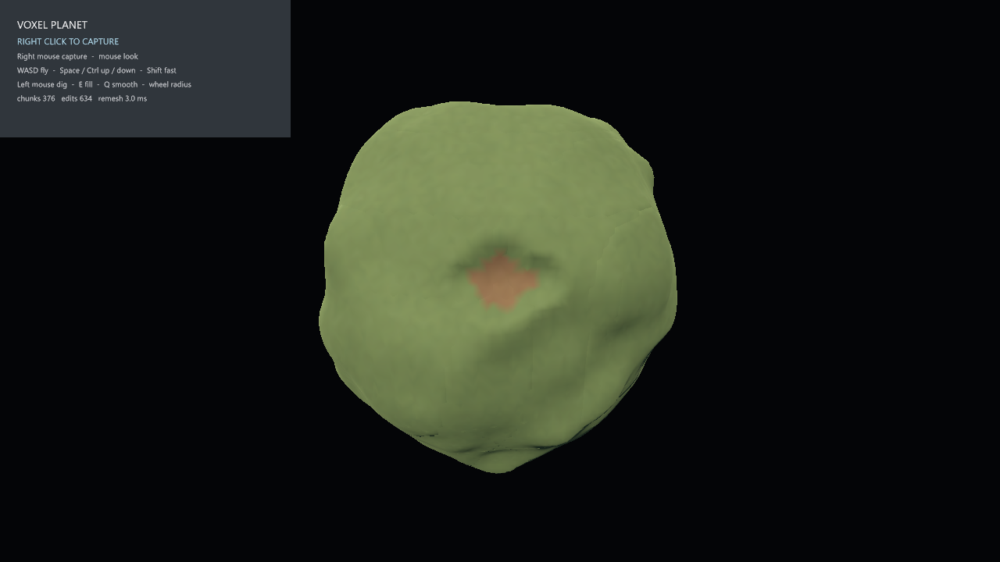

# Voxel Planet



A small, fully deformable planet driven by `V12.Voxel`: one element carries a
`VoxelPlanetComponent`, which builds a sparse set of 8 m chunk elements around a
1 m-voxel density field. Every chunk is an ordinary `IMeshRenderable`, so the
engine renders the terrain through the same path as any other mesh.

The camera starts facing a pre-carved crater so the depth strata and the edit
path are visible immediately. Dig anywhere to expose more.

## What it exercises

- `V12.Voxel`'s base field, sparse voxel edits and chunked surface-nets meshing.
- Per-vertex strata colour through the new `IMeshRenderable.MeshColors` channel.
- Engine render interpolation: the 60 Hz fixed step is slerped to the display
  rate in capture, so fly motion and mouse look stay smooth on a high-refresh
  monitor without changing the simulated pose.
- Brush raycasting and Dig / Fill / Smooth through `TryUseTool`, applied every
  fixed tick so digging follows the mouse.
- Budgeted remeshing: a brush marks chunks dirty and the planet rebuilds them
  nearest-first, 4 ms per tick, while the previous mesh stays on screen.
- Lazy chunk creation when a brush reaches a region that was not built at
  startup.

## Controls

| Input | Action |
|---|---|
| Right mouse | Capture / release the pointer |
| Mouse | Look while captured |
| `W A S D` | Fly |
| `Space` / `Ctrl` | Up / down |
| `Shift` | Fast |
| Left mouse | Dig at the crosshair |
| `E` (hold) | Fill |
| `Q` (hold) | Smooth |
| Mouse wheel | Brush radius |

The HUD reports live chunk count, edited-voxel count and the last remesh time.

## Run

Build the package, the sample, and the host (the host resolves optional packages
from its own output, so it must be rebuilt after a `V12.Voxel` change):

```powershell
dotnet build V12.Voxel/V12.Voxel.csproj
dotnet build V12-Samples/VoxelPlanet/VoxelPlanet.csproj
dotnet build NovaV2/NovaV2.Host/NovaV2.Host.csproj
.\scripts\run-host.ps1 -Demo VoxelPlanet -UseGame -Xr off
```

`-Xr off` keeps OpenXR from starting, as with every desktop sample.

`-UseGame` is important: without it, `run-host.ps1` prefers an exported
`V12-Samples/VoxelPlanet/bin/VoxelPlanet.exe` if one exists, which may be older
than the source. The current HUD reads `chunks N  edits N  remesh X ms`; the old
`voxel edits` wording means you launched a stale build.

If you launch through an installed renderer instead (`vcsdk build -r novav2`),
that renderer slot supplies the V12 assemblies. One command packs every
discovered `Finite.V12.*` package and installs missing assemblies into every
renderer slot:

```powershell
powershell -NoProfile -ExecutionPolicy Bypass -File tools/sync-v12.ps1
```

Verify with:

```powershell
powershell -NoProfile -ExecutionPolicy Bypass -File tools/check-v12-deps.ps1 -Renderer novav2 -IncludePackages
```

A stale slot missing `V12.Voxel.dll` produces a `VoxelPlanetComponent not found`
error because the gamepak assembly is fine but the planet component type cannot
resolve. The other cause is load order, not a missing dependency: a pak parses
its world before `IV12Gamepack.Initialize` runs, so `VoxelPlanetGamepack` pins
`V12.Voxel` in its static constructor (which runs when the gamepak is
instantiated, before world parsing). Do not move that load into `Initialize`:
WorldML would warn "Unknown component type 'VoxelPlanetComponent'" and silently
drop the planet.

## Notes

- The planet is not saved or replicated yet. Reloading rebuilds it from
  `VoxelPlanetComponent` settings plus the startup crater.
- `VoxelPlanetComponent` builds 376 chunks at startup (a ~0.2 s one-time hitch)
  and creates deeper chunks on demand.
- Meshing invariants live in `V12.Voxel.Tests`:

  ```powershell
  dotnet run --project V12.Voxel.Tests
  ```
